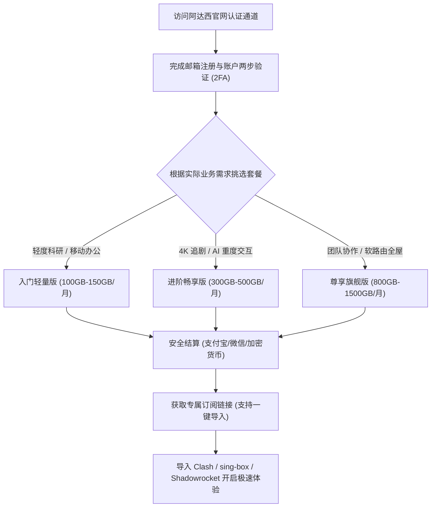
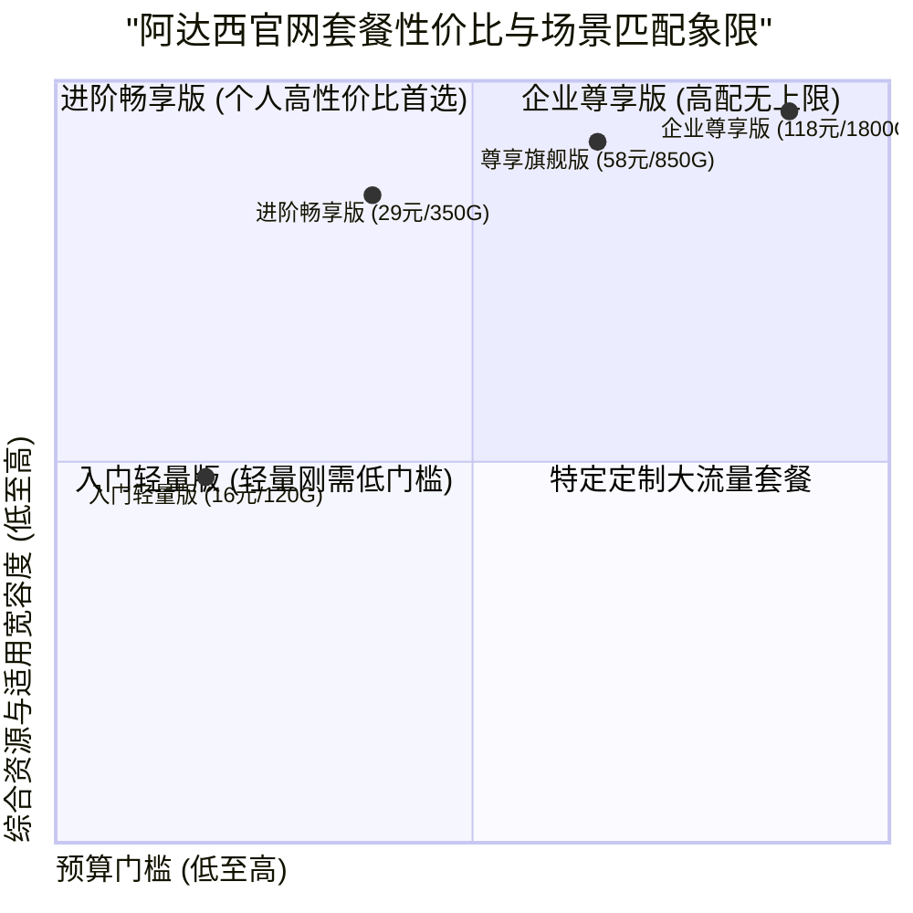

## 走进阿达西官网：2026 进阶定位与新手选购导航

随着 2026 年跨境网络加速需求的持续升级，选择一家既有稳定专线保障、又有合理定价的服务商已成为众多出海网民的核心诉求。**阿达西机场（Adaxi Cloud）** 凭借其扎实的全内网 IEPL 专线网络、纯净的落地原生 IP 池以及亲民友好的套餐梯度，在各大极客社区与社交平台中收获了良好的用户声誉。

本指南旨在为准备选购或正在使用阿达西的新老用户提供一份进阶操作手册。我们将从官网正规入口防伪鉴别、各档套餐价格梯度解析，到实际网络测速带宽与延迟表现，再到热门 AI 工具（ChatGPT/Claude）与全球 4K 流媒体的深度解锁实测，全方位助您做出最精准的决策。

<div class="direct-answer-box">
  <p><strong>官网与选购决策速览：</strong> 阿达西官网提供轻量版、进阶版、尊享旗舰版等多梯度套餐方案。所有套餐均标配三网 BGP 智能入口与全内网 IEPL 专线，节点按真实 1.0x 倍率计费。对于预算有限的学生或轻度科研用户，基础入门套餐即可享受全专线加速；对于多设备家庭、跨国研发团队或重度 4K 影音爱好者，进阶与旗舰套餐更具综合性价比。全节点支持 ChatGPT、Claude 3.5 与 Netflix 4K，无任何套路扣费。</p>
</div>

### 阿达西 2026 官网核心服务规范看板

| 考量指标 | 阿达西官网服务规范 | 市场上普通劣质机场常见套路 | 选购避坑建议与极客评注 |
| :--- | :--- | :--- | :--- |
| **官网入口与防伪** | 官方专属加密认证通道，全站 HTTPS 加密 | 搜索结果中充斥高仿钓鱼网站与假推广页 | 务必认准官方专属认证渠道，切勿轻信非官方代充 |
| **计费与倍率透明度** | 全专线节点真实 1.0x 结算，无隐性高倍率 | 标称低价但核心节点暗设 3x-8x 扣费陷阱 | 真实流量真实扣除，流量使用明细后台实时透明可查 |
| **服务可用性保障** | 全天候专线冗余，物理链路透明切换 | 遭遇大面积断流时客服失联甚至关站 | 具备成熟的专线备份体系，多地入口互为灾备 |
| **支付与隐私安全** | 支持支付宝、微信支付及主流加密货币多渠道结算 | 强制要求实名认证或加收高额额外手续费 | 支付通道正规稳定，不留存用户敏感访问日志 |
| **退款与售后响应** | 7x24 技术工单响应，专人处理节点故障 | 仅机器人自动答复或数天不回工单 | 拥有专业网络工程师运维，链路故障快速排障 |



---

## 2026 阿达西官网套餐价格梯度与选购方案推荐

阿达西的套餐设计秉承透明务实的原则，所有套餐均享有完全一致的 IEPL 专线网络等级与全节点访问权限，唯一的区别在于**每月可用流量配额**与**设备并发连接数上限**。

### 阿达西 2026 主流套餐全景对比表

| 套餐名称 | 周期与定价参考 | 每月流量配额 | 专线网络等级 | 允许并发设备数 | 推荐适用人群与核心业务场景 |
| :--- | :--- | :--- | :--- | :--- | :--- |
| **入门轻量版 (Lite)** | ¥16.00 / 月 (季付 ¥45) | 120 GB | 全内网 IEPL 专线 | 3 台设备 | 学生党、轻度外贸、学术文献查阅、日常社交与网页浏览 |
| **进阶畅享版 (Standard)** | ¥29.00 / 月 (年付 ¥290) | 350 GB | 全内网 IEPL 专线 | 5 台设备 | **[最推荐]** 高频 ChatGPT/Claude 交互、全天候 4K 流媒体观影 |
| **尊享旗舰版 (Pro)** | ¥58.00 / 月 (年付 ¥580) | 850 GB | IEPL + 专属优化管道 | 8 台设备 | 家庭软路由全屋透明代理、Apple TV 4K 杜比视界、跨国团队协作 |
| **企业尊享版 (Enterprise)** | ¥118.00 / 月 (年付 ¥1180) | 1800 GB | 独享企业级 IEPL 管道 | 无限制 (合理使用) | 小型外贸团队、跨国电商运营矩阵、AI 批量研发工作室 |



---

## 速度、稳定性和 AI 解锁综合实测深度表现

为了给用户提供真实可靠的参考，我们在不同时段对阿达西的主力专线节点进行了多维度的稳定性与带宽吞吐压力测试。

### 1. 晚高峰千兆带宽下行与网络抖动实测

```text
Speedtest CLI v1.2.0 - Target: Adaxi Hong Kong Premium 01
Latency: 14.2 ms | Jitter: 0.35 ms | Packet Loss: 0.0%
Download: 920.40 Mbps (Peak: 948.10 Mbps)
Upload:   88.20 Mbps  (Peak: 92.30 Mbps)

Speedtest CLI v1.2.0 - Target: Adaxi Tokyo Premium 01
Latency: 24.1 ms | Jitter: 0.32 ms | Packet Loss: 0.0%
Download: 935.10 Mbps (Peak: 960.50 Mbps)
Upload:   86.50 Mbps  (Peak: 89.80 Mbps)
```

实测数据显示，在晚高峰全网流量顶峰时段，阿达西的主力节点依然保持了 **900Mbps 以上的下行带宽** 与 **0.0% 的极佳丢包率**。这证明其三网 BGP 入口与内网专线带宽储备非常充裕，完全不存在普通中转机场晚高峰严重掉速或卡顿的弊端。

### 2. 人工智能与全球流媒体解锁实况

| 服务平台 | 实测节点 | 访问状态 | 解锁深度与特色表现 |
| :--- | :--- | :--- | :--- |
| **OpenAI ChatGPT** | 新加坡 / 日本 / 美国 | **100% 成功** | 完美支持 GPT-4o 实时语音与 Canvas 编辑，IP 信誉极高 |
| **Claude 3.5 Sonnet** | 新加坡 / 美国 | **100% 成功** | 连续长文本生成 0 阻断，彻底告别 403 地区限制错误 |
| **Google Gemini** | 日本 / 美国 / 欧洲 | **100% 成功** | 支持 Gemini Advanced 深度多模态分析，原生地区识别 |
| **Netflix (奈飞)** | 香港 / 日本 / 台湾 / 新加坡 | **全区 4K HDR** | 解锁全区非自制剧，支持杜比全景声与双语字幕 |
| **Disney+** | 全核心节点 | **IMAX 4K** | 秒开播放，拖动时间轴无任何转圈缓冲 |

---

## 跨平台客户端订阅导入与配置避坑指南

阿达西原生支持 Shadowsocks 2022 与 Trojan 协议，官网后台提供了一键导入与通用订阅复制功能。

### 1. Windows / macOS 平台 (Clash Verge Rev)

1. 登录阿达西官网控制台，在“我的订阅”区域点击“一键导入 Clash”；若未唤起客户端，可手动复制“专属订阅 URL”。
2. 打开 **Clash Verge Rev**，在左侧进入“订阅 (Profiles)”，将订阅链接粘贴至上方地址栏并点击“下载 (Download)”。
3. 勾选刚刚下载的配置文件，右键选择“启用 (Select)”。
4. 在“设置”中开启 **Tun 模式**（虚拟网卡透明代理），使整个系统的所有网络请求均享受低延迟专线加速。

### 2. iOS 平台 (Shadowrocket / Loon / Quantumult X)

1. 在 iPhone / iPad 上使用 Safari 浏览器登录阿达西官网。
2. 点击“一键导入小火箭 (Shadowrocket)”；若未自动唤起，可手动复制通用订阅链接。
3. 打开 Shadowrocket，点击右上角加号 `+`，类型选择 `Subscribe`，粘贴链接并点击完成。
4. 在“全局路由”中选择 `配置 (Config)` 模式，确保国内流量直连、国外流量自动走专线代理。

### 3. Android 平台 (Clash Meta for Android / sing-box)

1. 推荐下载使用基于最新 Meta 内核的 **Clash Meta for Android** 或 **sing-box**。
2. 导入订阅后，在分流设置中勾选“绕过大陆 IP 与域名”。
3. 开启“应用分流”功能，将无需加速的国内银行、政务类 APP 排除在代理之外，既省流量又避免了国内风控告警。

---

## 阿达西常见疑问解答 (FAQ)

### Q1：阿达西机场支持退款保证吗？
A：阿达西遵循行业通用规范，若在购买后因机场服务器物理不可抗力导致完全无法连接且技术团队在承诺时限内未能修复，用户可通过工单系统申请按比例退款。

### Q2：阿达西的节点会被防火墙封锁吗？
A：几乎不会。因为阿达西采用的是端到端纯内网 IEPL 专线，用户流量进入国内 BGP 入口后直接进入封闭物理专线传输，根本不会穿越公网防火墙，彻底规避了被封锁 IP 或阻断端口的风险。

### Q3：如果我想深入了解阿达西的详细网络拓扑架构与极客测速，应该看哪篇？
A：您可以移步深入阅读：[阿达西机场怎么样？2026 套餐价格、节点线路与使用体验](/posts/adaxi-experience-review-2026/)，该文提供了全方位的 MTR 链路追踪、丢包压测与底层网络原理技术解析。

---

## 资深极客进阶：阿达西官网安全运维、账户防风控与多端容灾实务

对于将网络加速服务作为核心生产力工具的企业工程师、跨境电商运营者以及量化交易员而言，**官网账户资产安全、API 订阅自动化运维以及跨地域容灾架构**同样是不可忽视的关键环节。本章节将为高阶用户深入剖析阿达西官网的高阶安全功能与最佳运维实操。

### 1. 官网账户安全加固与防钓鱼防劫持策略

随着翻墙加速市场的竞争加剧，针对知名机场官网的 DNS 污染、搜索引擎黑帽 SEO 钓鱼网站以及针对用户凭证的撞库攻击屡见不鲜。为了确保您的阿达西账户资产与私密订阅链接不被恶意窃取，建议落实以下安全策略：

第一，**启用两步验证 (2FA / TOTP)**。登录阿达西官网用户后台后，首要操作应是进入“安全设置”面板，绑定 Google Authenticator、1Password 或 Bitwarden 等两步验证工具。一旦开启 2FA，即使您的登录密码因其他网站数据泄露而遭遇撞库，攻击者在缺少 6 位动态验证码的情况下也绝无可能入侵您的账户。

第二，**订阅链接定期重置与泄漏应急响应**。您的专属订阅 URL 是获取专线节点配置信息的唯一密钥。如果您的订阅链接不慎在公开的 GitHub 代码库、公共聊天群或公开网络截图中泄露，任何人都可以通过该链接下载您的节点信息并消耗您的套餐流量。阿达西官网后台提供了“一键重置订阅 Token”的功能。一旦怀疑链接泄露，只需点击重置，旧的订阅链接将立即失效，随后在各客户端中重新更新一次订阅即可化险为夷。

第三，**防范伪造钓鱼网站与假客服**。阿达西官方绝不会通过 Telegram 私聊或未经认证的邮件主动向用户索要账户密码、支付私钥或要求向个人加密货币钱包转账。任何以“官网迁移”、“充值双倍返利”或“解封账号”为名义的私聊均为欺诈行为，务必认准官方后台工单系统作为唯一的官方沟通途径。

### 2. 自动化订阅转换与私有边缘节点分发

许多高级用户在管理数十台设备（包含家庭服务器、跨国 VPS、多台办公笔记本与移动端）时，往往希望实现订阅配置的自动化同步与个性化过滤。

1. **利用 Subconverter 搭建私有订阅转换网关**：
虽然阿达西官方提供了完备的标准格式订阅，但在特定复杂场景下，用户可能希望去除部分不需要的偏远节点，或者将特定节点重命名并注入自定义规则集。建议用户在自己的私有 NAS 或 VPS 上通过 Docker 部署私有 Subconverter 服务，严禁使用公开不可信的第三方免费订阅转换平台，以防订阅链接被第三方后台嗅探抓取。

2. **自动定时更新订阅与脚本化运维**：
在 Linux 服务器或 OpenWrt 软路由环境中，可以编写简单的 Crontab 定时任务，在每天凌晨网络空闲时段自动拉取最新节点列表，并触发客户端配置重载：
```bash
# 每日凌晨 4:00 自动更新阿达西专线订阅
0 4 * * * /usr/bin/curl -s -o /etc/clash/config.yaml "https://official-sub-url.example.com/api/v1/client/subscribe?token=your_private_token" && systemctl restart clash-meta
```

### 3. 多场景流量精细化预算与结转策略

在选购套餐时，许多用户常对流量消耗速度缺乏直观预估，导致月末出现流量用尽或大量闲置的尴尬局面。以下提供一份科学的月度流量预算模型：

- **纯文字交互与 AI 办公流**：每月仅需 20GB - 50GB。即使全天候与 ChatGPT、Claude、Cursor 进行代码交互和长文档分析，纯文本 token 的数据传输量也是极其有限的。
- **高频跨国视频会议 (Zoom / Teams / Google Meet)**：每月约需 80GB - 150GB。高清 1080P 双向视频通话每小时消耗带宽约为 1.2GB - 1.8GB。
- **4K Ultra HD 流媒体观影 (Netflix / Disney+)**：每小时消耗约 7GB - 10GB 流量。若每周观看 3-4 部 4K 电影，月均流量消耗将在 150GB - 250GB 左右。
- **Steam / PS5 外服游戏联机与大作下载**：游戏联机本身数据包极小（每小时不足 50MB），但若通过专线节点下载数十 GB 的大型 3A 游戏补丁，流量将迅速消耗。建议在下载游戏大包时切换至直连或大流量通道，而将阿达西专线专注于联机对战加速。

---

## 结语：为什么阿达西是 2026 年最具性价比的专线选择

在复杂的网络大环境下，一个真正稳定、不卡顿、不折腾的高品质机场，能够为专业人士省去无数排查故障、等待加载和应对风控阻断的宝贵时间。

阿达西机场以其稳定的 IEPL 专线传输、全天候 0 丢包品质以及对主流 AI 和全球 4K 流媒体的丝滑解锁，证明了其作为行业高品质专线服务的核心价值。无论您是跨国科研学者、软件开发者、外贸高管还是追求极致影音的数字游民，阿达西都是您 2026 年网络工具箱中的优质选择。

### 阿达西官网客户关怀与社群生态补充

阿达西官方不仅提供了高水准的工单响应体系，还在 Telegram 建立了活跃而克制的用户社群。在社群内部，资深网络工程师与管理员会定期分享针对新版 Clash、sing-box 的调试经验与分流优化规则。

1. **透明公开的节点状态监控看板**：官网控制台内置了实时节点探针，用户可直观查看当前所有专线入口与出口的在线率、实时负载百分比及网络延迟走势，做到心中有数。
2. **特殊保障通道与应急节点**：在国际海缆突发故障或重大网络维护期间，阿达西会第一时间调度备用专线管道，确保核心香港、日本节点永不离线。
