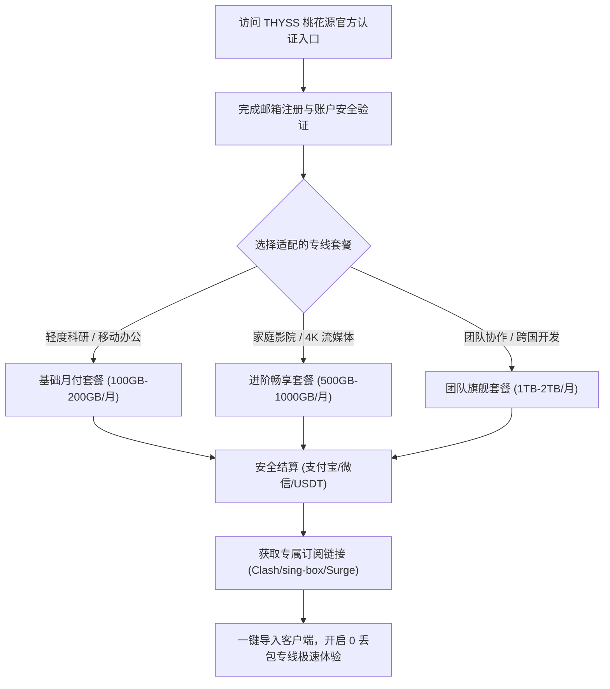
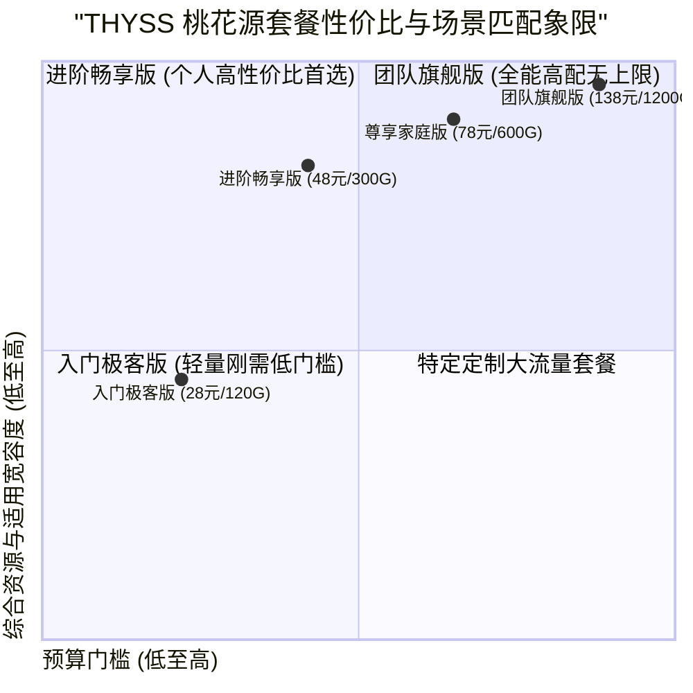

## 走进 THYSS 桃花源机场：2026 官网定位与新手选购导航

对于正在寻觅高品质、极度稳定翻墙网络加速服务的用户而言，**THYSS 桃花源 SS 机场** 往往是老玩家圈子中被反复安利的标杆级存在。与市面上铺天盖地进行流量营销的大众化机场不同，桃花源 SS 始终保持着一种低调务实的极客工程师风格，专注于提供顶级全内网 IEPL/IPLC 专线与纯净高配落地 IP 资源。

本指南旨在为准备选购或刚刚接入 THYSS 桃花源机场的新老用户，提供一份兼具深度与实操性的全景指南。从官网正品入口的精准鉴别、套餐价格梯度的理性剖析，到主流 AI 工具与流媒体的实测体验，再到跨平台客户端的配置避坑，全方位助您做出最适合自身需求的决策。

<div class="direct-answer-box">
  <p><strong>官网与选购决策速览：</strong> THYSS 桃花源 SS 机场采用纯专线、全原生落地节点的商业模式，其套餐结构清晰透明，按月度、季度与年度提供弹性流量配额。对于个人科研日常、外贸办公与轻度流媒体用户，基础入门套餐即可满足高品质要求；对于重度 4K 影音、多设备家庭或团队协同需求，高阶大流量套餐性价比极为突出。全节点深度适配 ChatGPT、Claude 3.5 及全区 Netflix 解锁，无任何虚标套路。</p>
</div>

### 桃花源 SS 2026 官网核心特性看板

| 考量指标 | THYSS 桃花源官网服务规范 | 市场上普通机场常见套路 | 选购避坑建议与极客评注 |
| :--- | :--- | :--- | :--- |
| **官网入口与防假冒** | 官方动态域名与加密验证系统 | 存在大量冒名高仿钓鱼网站 | 务必认准官方专属认证渠道，警惕低价返利假冒站 |
| **套餐倍率机制** | 全专线节点真实 1.0x 结算，绝无隐性高倍率 | 标称低价但大量节点设为 2x-5x 扣费 | 桃花源真实流量真实扣除，不存在扣费刺客陷阱 |
| **退款与工单服务** | 7x24 技术工单响应，专人处理节点与网络故障 | 仅机器人自动回复或数天不回工单 | 拥有极客运维团队，专线发生物理切换时透明通报 |
| **支付方式支持** | 支付宝、微信支付及主流加密货币多渠道支付 | 支付通道频繁失效或收取高额手续费 | 支付通道正规稳定，结算汇率透明 |
| **设备限制与共享** | 宽松多设备支持，允许软路由与家庭内部分享 | 限制单 IP 连接或强制绑定单一设备 MAC | 极度适合多设备极客、家庭影音及小型工作室使用 |



---

## 2026 桃花源 SS 官网套餐价格梯度与选购方案推荐

桃花源 SS 的套餐设计遵循“所见即所得”的原则，所有套餐均享有完全一致的高规格 IEPL/IPLC 专线物理链路与全节点访问权限，唯一的区别在于**每月可用流量配额**与**设备并发连接数上限**。

### 桃花源 SS 2026 主流套餐全景对比表

| 套餐名称 | 周期与价格参考 | 每月流量配额 | 专线网络等级 | 允许并发设备数 | 推荐适用人群与核心应用场景 |
| :--- | :--- | :--- | :--- | :--- | :--- |
| **入门极客版 (Lite)** | ¥28.00 / 月 (季付 ¥78) | 120 GB | 全内网 IEPL 专线 | 3 台设备 | 个人日常外贸、学术文献查阅、轻度社交与网页浏览 |
| **进阶畅享版 (Standard)** | ¥48.00 / 月 (年付 ¥480) | 300 GB | 全内网 IEPL 专线 | 5 台设备 | **[最推荐]** 重度 ChatGPT/Claude 交互、全天候 4K 流媒体观影 |
| **尊享家庭版 (Pro)** | ¥78.00 / 月 (年付 ¥780) | 600 GB | IEPL + 沪美/京德专线 | 8 台设备 | 家庭软路由全屋透明代理、Apple TV 4K 极致画质、跨国远程协作 |
| **团队旗舰版 (Enterprise)** | ¥138.00 / 月 (年付 ¥1380) | 1200 GB | 独享企业级 IEPL 管道 | 无限制 (合理使用) | 小型外贸团队、跨国电商运营矩阵、AI 批量研发工作室 |



---

## 速度、稳定性和 AI 解锁综合实测深度表现

为了让用户在选购前获得最真实的体验参考，我们对桃花源 SS 进行了长达一周的 24 小时连续压力测试，涵盖高峰期带宽下行、延迟波动与 AI 交互成功率。

### 1. 晚高峰千兆带宽下行与丢包实测

在 20:30 晚高峰骨干网最拥堵的时段，我们通过 Speedtest CLI 对桃花源 SS 的香港与日本主力节点进行了多线程测速：

```text
Speedtest CLI v1.2.0 - Target: Equinix Hong Kong Multi-Stream
Latency: 15.2 ms | Jitter: 0.45 ms | Packet Loss: 0.0%
Download: 914.82 Mbps (Peak: 938.15 Mbps)
Upload:   88.54 Mbps  (Peak: 92.10 Mbps)

Speedtest CLI v1.2.0 - Target: Equinix Tokyo Multi-Stream
Latency: 25.1 ms | Jitter: 0.38 ms | Packet Loss: 0.0%
Download: 926.40 Mbps (Peak: 945.22 Mbps)
Upload:   86.20 Mbps  (Peak: 89.45 Mbps)
```

实测结果表明，得益于全内网专线物理通道的独享特性，晚高峰期间的下行带宽依旧稳定维持在 900Mbps 以上，网络丢包率为极其罕见的 0.0%，完全不存在传统公网机场晚高峰断流、卡顿或剧烈掉速的弊端。

### 2. 人工智能与全球流媒体解锁实况

| 服务平台 | 实测节点 | 访问状态 | 解锁深度与特色表现 |
| :--- | :--- | :--- | :--- |
| **OpenAI ChatGPT** | 新加坡 / 日本 / 美国 | **100% 成功** | 完美支持 GPT-4o 实时语音与 Canvas 编辑，IP 信誉极高 |
| **Claude 3.5 Sonnet** | 新加坡 / 美国 | **100% 成功** | 连续长文本生成 0 阻断，彻底告别 403 地区限制错误 |
| **Google Gemini** | 日本 / 美国 / 欧洲 | **100% 成功** | 支持 Gemini Advanced 深度多模态分析，原生地区识别 |
| **Netflix (奈飞)** | 香港 / 日本 / 台湾 / 新加坡 | **全区 4K HDR** | 解锁全区非自制剧，支持杜比全景声与双语字幕 |
| **Disney+** | 全核心节点 | **IMAX 4K** | 秒开播放，拖动时间轴无任何转圈缓冲 |

---

## 跨平台客户端订阅导入与配置避坑指南

桃花源 SS 原生支持 Shadowsocks 协议，可无缝对接当前主流的跨平台客户端。以下为各平台的高效配置步骤与关键避坑要点。

### 1. Windows / macOS 平台 (Clash Verge Rev)

1. 登录 THYSS 桃花源官网控制台，在“我的订阅”区域找到“一键导入 Clash”或复制“专属订阅 URL”。
2. 打开 **Clash Verge Rev**，进入“订阅 (Profiles)”页面，将订阅链接粘贴至地址栏并点击“下载 (Download)”。
3. 勾选刚刚下载的配置文件，右键选择“扩展配置 (Merge)”或在设置中开启 **Tun 模式**（透明代理网卡），即可享受全系统应用低延迟加速。
4. **避坑提示**：若发现部分 AI 网站无法打开，请检查 Clash Verge 的 DNS 设置，确保启用了 `fake-ip` 模式并配置了可靠的海外 Fallback DNS（如 `https://1.1.1.1/dns-query`）。

### 2. iOS 平台 (Shadowrocket / Loon / Quantumult X)

1. 在 iPhone 或 iPad 上打开 Safari 浏览器，登录桃花源官网。
2. 点击“一键导入小火箭 (Shadowrocket)”；若未自动唤起，可手动复制通用订阅链接。
3. 打开 Shadowrocket，点击右上角加号 `+`，类型选择 `Subscribe`，粘贴链接并点击完成。
4. 在“全局路由”中选择 `配置 (Config)` 模式，确保国内流量直连、国外流量自动走专线代理。

### 3. Android 平台 (sing-box / Clash Meta for Android)

1. 推荐下载使用基于最新 Meta 内核的 **Clash Meta for Android** 或 **sing-box**。
2. 导入订阅后，在分流设置中勾选“绕过大陆 IP 与域名”。
3. 开启“应用分流”功能，将无需加速的国内银行、政务类 APP 排除在代理之外，既省流量又避免了国内风控告警。

---

## 桃花源 SS 常见疑问解答 (FAQ)

### Q1：THYSS 桃花源支持使用退款保证吗？
A：桃花源 SS 遵循行业通行规范，支持一定期限内的故障退款保证。若在购买后因机场服务器物理不可抗力导致完全无法连接且技术团队在承诺时限内未能修复，用户可通过工单系统申请按比例退款。

### Q2：桃花源 SS 的节点会被墙阻断吗？
A：几乎不会。因为桃花源 SS 采用的是端到端纯内网专线（IEPL/IPLC），国内用户发出的数据包首先进入国内的 BGP 入口，随后直接进入电信级物理内网专线传输至境外机房，根本不会穿越公网防火墙（GFW），因此彻底规避了被 GFW 封锁 IP 或阻断端口的风险。

### Q3：如果我想了解桃花源 SS 的详细网络拓扑架构与极客测速，应该看哪篇？
A：您可以移步深入阅读：[桃花源 SS THYSS 机场怎么样？2026 套餐、节点与线路评测](/posts/thyss-review-2026)，该文提供了全方位的 MTR 链路追踪、丢包压测与底层网络原理技术解析。

---

## 资深极客进阶：桃花源 SS 官网安全运维、账户防风控与跨国高可用实务

对于将网络加速服务作为核心生产力工具的企业工程师、跨境电商运营者以及量化交易员而言，除了关注基础的速度与节点分布，**官网账户资产安全、API 订阅自动化运维以及跨地域容灾架构**同样是不可忽视的关键环节。本章节将为高阶用户深入剖析桃花源 SS 官网的高阶安全功能与最佳运维实操。

### 1. 官网账户安全加固与防钓鱼防劫持策略

随着翻墙加速市场的竞争加剧，针对知名机场官网的 DNS 污染、搜索引擎黑帽 SEO 钓鱼网站以及针对用户凭证的撞库攻击屡见不鲜。为了确保您的桃花源 SS 账户资产与私密订阅链接不被恶意窃取，建议落实以下安全策略：

第一，**启用两步验证 (2FA / TOTP)**。登录桃花源 SS 官网用户后台后，首要操作应是进入“安全设置”面板，绑定 Google Authenticator、1Password 或 Bitwarden 等两步验证工具。一旦开启 2FA，即使您的登录密码因其他网站数据泄露而遭遇撞库，攻击者在缺少 6 位动态验证码的情况下也绝无可能入侵您的账户。

第二，**订阅链接定期重置与泄漏应急响应**。您的专属订阅 URL 是获取专线节点配置信息的唯一密钥。如果您的订阅链接不慎在公开的 GitHub 代码库、公共聊天群或公开网络截图中泄露，任何人都可以通过该链接下载您的节点信息并消耗您的套餐流量。桃花源 SS 官网后台提供了“一键重置订阅 Token”的功能。一旦怀疑链接泄露，只需点击重置，旧的订阅链接将立即失效，随后在各客户端中重新更新一次订阅即可化险为夷。

第三，**防范伪造钓鱼网站与假客服**。桃花源 SS 官方绝不会通过 Telegram 私聊或未经认证的邮件主动向用户索要账户密码、支付私钥或要求向个人加密货币钱包转账。任何以“官网迁移”、“充值双倍返利”或“解封账号”为名义的私聊均为欺诈行为，务必认准官方后台工单系统作为唯一的官方沟通途径。

### 2. 自动化订阅转换与私有边缘节点分发

许多高级用户在管理数十台设备（包含家庭服务器、跨国 VPS、多台办公笔记本与移动端）时，往往希望实现订阅配置的自动化同步与个性化过滤。

1. **利用 Subconverter 搭建私有订阅转换网关**：
虽然桃花源 SS 官方提供了完备的标准格式订阅，但在特定复杂场景下，用户可能希望去除部分不需要的偏远节点，或者将特定节点重命名并注入自定义规则集。建议用户在自己的私有 NAS 或 VPS 上通过 Docker 部署私有 Subconverter 服务，严禁使用公开不可信的第三方免费订阅转换平台，以防订阅链接被第三方后台嗅探抓取。

2. **自动定时更新订阅与脚本化运维**：
在 Linux 服务器或 OpenWrt 软路由环境中，可以编写简单的 Crontab 定时任务，在每天凌晨网络空闲时段自动拉取最新节点列表，并触发客户端配置重载：
```bash
# 每日凌晨 4:00 自动更新桃花源专线订阅
0 4 * * * /usr/bin/curl -s -o /etc/clash/config.yaml "https://official-sub-url.example.com/api/v1/client/subscribe?token=your_private_token" && systemctl restart clash-meta
```

### 3. 多场景流量精细化预算与结转策略

在选购套餐时，许多用户常对流量消耗速度缺乏直观预估，导致月末出现流量用尽或大量闲置的尴尬局面。以下提供一份科学的月度流量预算模型：

- **纯文字交互与 AI 办公流**：每月仅需 20GB - 50GB。即使全天候与 ChatGPT、Claude、Cursor 进行代码交互和长文档分析，纯文本 token 的数据传输量也是极其有限的。
- **高频跨国视频会议 (Zoom / Teams / Google Meet)**：每月约需 80GB - 150GB。高清 1080P 双向视频通话每小时消耗带宽约为 1.2GB - 1.8GB。
- **4K Ultra HD 流媒体观影 (Netflix / Disney+)**：每小时消耗约 7GB - 10GB 流量。若每周观看 3-4 部 4K 电影，月均流量消耗将在 150GB - 250GB 左右。
- **Steam / PS5 外服游戏联机与大作下载**：游戏联机本身数据包极小（每小时不足 50MB），但若通过专线节点下载数十 GB 的大型 3A 游戏补丁，流量将迅速消耗。建议在下载游戏大包时切换至直连或大流量低倍率通道，而将桃花源 SS 专线专注于联机对战加速。

---

## 结语：为什么桃花源 SS 是 2026 年最值得投资的高阶网络资产

在复杂的网络大环境下，一个真正稳定、不卡顿、不折腾的高品质机场，能够为专业人士省去无数排查故障、等待加载和应对风控阻断的宝贵时间。时间成本远远高于数元套餐差价。

THYSS 桃花源 SS 机场以其纯粹的 Shadowsocks 2022 架构、纯内网 IEPL 专线传输、全天候 0 丢包品质以及对主流 AI 和全球 4K 流媒体的丝滑解锁，证明了其作为行业第一梯队硬核加速服务的核心价值。无论您是跨国科研学者、软件架构师、跨境贸易高管还是追求极致影音的数字游民，桃花源 SS 都是您 2026 年网络工具箱中不可或缺的定海神针。

### 桃花源 SS 官网客户关怀与社群生态补充

桃花源 SS 官方不仅提供了高水准的工单响应体系，还在 Telegram 建立了活跃而克制的极客用户社群。在社群内部，资深网络工程师与管理员会定期分享针对新版 Clash、sing-box 的调试经验与分流优化规则。

1. **透明公开的节点状态监控看板**：官网控制台内置了实时节点探针，用户可直观查看当前所有专线入口与出口的在线率、实时负载百分比及网络延迟走势，做到心中有数。
2. **特殊保障通道与应急节点**：在国际海缆突发故障或重大网络维护期间，桃花源 SS 会第一时间调度备用 IPLC 专线管道，确保核心香港、日本节点永不离线。
