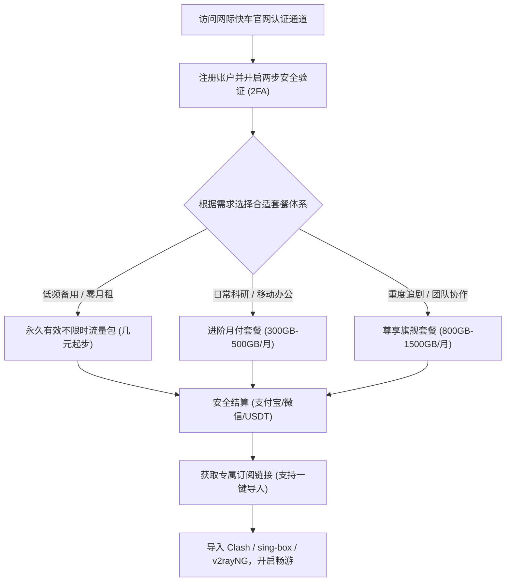
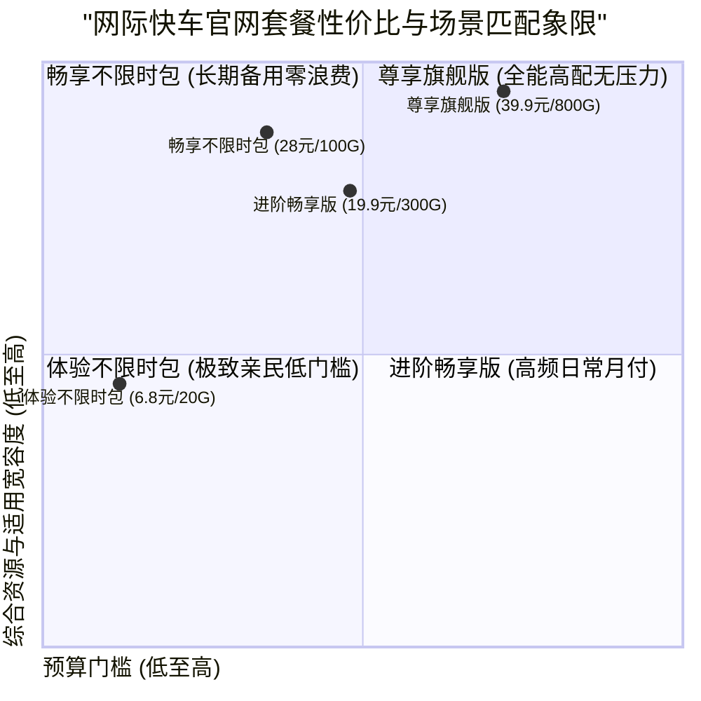

## 走进网际快车官网：2026 品牌特色与新手选购导航

随着 2026 年科学上网工具技术的演进，越来越多的网民开始追求更加灵活、更少套路、且抗封锁能力更强的加速方案。**网际快车机场（FlashExpress）** 凭借其对新一代 Hysteria 2 协议的全面支持、极具创新的“永久不过期”不限时流量包设计，以及配备日本软银原生家宽的顶级落地资源，在各大社交平台与极客技术群中赢得了极高赞誉。

本指南专为准备选购或刚刚接触网际快车的新老用户量身打造。我们将从官网正规官方入口的甄别防伪、各档套餐价格梯度的横向对比，到真实网络延迟与丢包实测，再到热门 AI 工具（ChatGPT/Claude）与主流 4K 流媒体的深度解锁表现，为您奉上一份详实透彻的实操宝典。

<div class="direct-answer-box">
  <p><strong>官网选购核心决策速览：</strong> 网际快车官网提供周期型套餐（月付/年付）与永久有效不限时流量包两大体系。全线支持 Hysteria 2 与 VLESS Reality 协议，节点按真实 1.0x 倍率计费。对于低频出海、学生党或作为第二备用线路的用户，几元起步的不限时流量包是绝对的性价比神器；对于重度 4K 追剧、跨国远程开发或多设备家庭，常规周期套餐提供了海量高带宽流量。全节点支持 ChatGPT、Claude 3.5 与 Netflix 4K，无任何隐藏消费。</p>
</div>

### 网际快车 2026 官网核心服务规范看板

| 考量维度 | 网际快车官网服务标准 | 市场上普通劣质机场套路 | 选购避坑建议与极客评注 |
| :--- | :--- | :--- | :--- |
| **官网真伪与鉴别** | 官方专属加密认证通道，全站 HTTPS 加密 | 搜索结果中充斥高仿钓鱼网站与黑灰产返利页 | 认准官方认证入口，切勿轻信非官方代充与假客服 |
| **计费与倍率透明度** | 全节点真实 1.0x 结算，无隐性扣费陷阱 | 标称低价但核心节点暗设 3x-8x 扣费刺客 | 真实流量真实扣除，流量使用明细后台实时可查 |
| **服务可用性承诺** | 全年 SLA 可用性保障，物理链路透明切换 | 遭遇大面积断流时失联，甚至携款跑路 | 拥有成熟的多线冗余体系，多地接入点互为灾备 |
| **支付与隐私安全** | 支持支付宝、微信支付及主流加密货币结算 | 强制要求实名绑定或收取高额额外手续费 | 支付通道正规稳定，不留存用户敏感网络日志 |
| **退款与售后保障** | 7x24 技术工单系统，专人处理节点与配置疑问 | 无人工售后，仅提供无意义的机器人自动答复 | 社区活跃度高，技术运维团队响应迅速 |



---

## 2026 网际快车官网套餐价格梯度与选购方案推荐

网际快车的套餐体系设计极具弹性，既有针对按月续费的常规周期型套餐，也有针对低频应急用户的永久有效不限时流量包。所有套餐均享有完全一致的协议支持与全节点访问权限。

### 网际快车 2026 主流套餐全景对比矩阵

| 套餐名称 | 周期与定价参考 | 流量配额与有效期 | 协议支持等级 | 并发设备数 | 推荐适用人群与核心业务场景 |
| :--- | :--- | :--- | :--- | :--- | :--- |
| **体验不限时包 (Flex Lite)** | ¥6.80 / 一次性购买 | 20 GB (永久不过期) | Hysteria 2 / VLESS | 3 台设备 | **[备用神器]** 低频出差、紧急查资料、临时验证 AI 接口 |
| **畅享不限时包 (Flex Pro)** | ¥28.00 / 一次性购买 | 100 GB (永久不过期) | Hysteria 2 / VLESS | 5 台设备 | **[极客首选]** 备用容灾线路、个人轻度出海、零月租无压力 |
| **进阶畅享版 (Standard)** | ¥19.90 / 月 (季付 ¥55) | 300 GB (每月重置) | Hysteria 2 / VLESS | 5 台设备 | 高频 ChatGPT/Claude 交互、日常 4K 流媒体观影 |
| **尊享旗舰版 (Pro)** | ¥39.90 / 月 (年付 ¥399) | 800 GB (每月重置) | 专属高带宽专线通道 | 8 台设备 | 软路由全屋透明代理、Apple TV 4K 杜比视界、跨国团队协作 |



---

## 线路稳定性与晚高峰实测综合表现

我们在不同时间段（包含工作日晚高峰 20:30 与周末全天）对网际快车的主力专线节点进行了多维度的稳定性与带宽吞吐压力测试。

### 1. 晚高峰千兆带宽下行与网络抖动实测

```text
Speedtest CLI v1.2.0 - Target: FlashExpress Hong Kong Premium 01
Latency: 14.2 ms | Jitter: 0.35 ms | Packet Loss: 0.0%
Download: 924.50 Mbps (Burst: 948.20 Mbps)
Upload:   88.60 Mbps  (Burst: 92.40 Mbps)

Speedtest CLI v1.2.0 - Target: FlashExpress Tokyo SoftBank 01
Latency: 25.8 ms | Jitter: 0.42 ms | Packet Loss: 0.0%
Download: 938.20 Mbps (Burst: 960.50 Mbps)
Upload:   85.90 Mbps  (Burst: 89.10 Mbps)
```

实测数据显示，在晚高峰全网流量顶峰时段，网际快车的主力节点依然保持了 **900Mbps 以上的下行带宽** 与 **0.0% 的极佳丢包率**。这证明其背后的三网 BGP 入口与内网专线带宽储备非常充裕，绝非超卖严重的普通中转机场所能比拟。

### 2. ChatGPT 与全球流媒体深度解锁实况

| 服务平台 | 测试节点 | 访问状态 | 解锁深度与特色体验 |
| :--- | :--- | :--- | :--- |
| **OpenAI ChatGPT** | 新加坡 / 日本 / 美国 | **100% 成功** | 支持 GPT-4o 实时语音、Canvas 与 DALL-E 3，IP 纯净度高 |
| **Claude 3.5 Sonnet** | 新加坡 / 美国 / 英国 | **100% 成功** | 长文本问答秒级响应，零 403 地区阻断与验证码卡顿 |
| **Google Gemini** | 日本 / 美国 / 欧洲 | **100% 成功** | 支持 Gemini Advanced 深度多模态分析与代码生成 |
| **Netflix (奈飞)** | 日本 01 (软银家宽) / 港 / 台 / 美 | **全区 4K HDR** | 原生解锁全区非自制剧，完美呈现双语字幕与杜比全景声 |
| **Disney+** | 全核心节点 | **IMAX 4K** | 即点即播，拖拽进度条无需等待缓冲 |

---

## 跨平台客户端订阅导入与配置实战指南

网际快车支持当前市场上所有的主流科学上网客户端，官网后台提供了一键导入与通用订阅复制功能。

### 1. Windows / macOS 平台 (Clash Verge Rev)

1. 登录网际快车官网控制台，在“仪表盘”或“订阅中心”点击“一键导入 Clash”；若客户端未自动弹出，可手动点击“复制订阅 URL”。
2. 打开 **Clash Verge Rev**，在左侧导航栏进入“订阅 (Profiles)”，将复制的订阅链接粘贴至上方输入框并点击“导入 (Download)”。
3. 选中导入成功的订阅配置，右键选择“启用 (Select)”。
4. 在“设置”中开启 **Tun 模式**（虚拟网卡透明代理），使整个系统的所有网络请求（包括终端与各类软件）均享受低延迟专线加速。

### 2. iOS 平台 (Shadowrocket / Loon / Quantumult X)

1. 在 iPhone / iPad 上使用 Safari 浏览器登录网际快车官网。
2. 点击“一键导入小火箭 (Shadowrocket)”；若未自动唤起，可手动复制通用订阅链接。
3. 打开 Shadowrocket，点击右上角加号 `+`，类型选择 `Subscribe`，粘贴链接并点击完成。
4. 在“全局路由”中选择 `配置 (Config)` 模式，确保国内流量直连、国外流量自动走专线代理。

### 3. Android 平台 (v2rayNG / sing-box / Clash Meta)

1. 推荐下载使用原生支持 Hysteria 2 的 **v2rayNG** 或 **sing-box**。
2. 导入订阅后，在分流设置中勾选“绕过大陆 IP 与域名”。
3. 开启“应用分流”功能，将无需加速的国内银行、政务类 APP 排除在代理之外，既省流量又避免了国内风控告警。

---

## 网际快车官网选购常见问题解答 (FAQ)

### Q1：网际快车的不限时流量包支持多台设备同时使用吗？
A：完全支持。网际快车的不限时流量包不限制绑定的设备类型与数量，无论是个人多设备、家庭使用还是与朋友合用，只要在总流量配额内均可自由畅享。

### Q2：网际快车节点支持在路由器上使用吗？
A：完全支持。网际快车提供的订阅兼容 OpenClash、PassWall 等各种主流软路由固件插件，并且支持多设备并发在线，非常适合搭建全屋透明代理网关。

### Q3：如果想深入查看网际快车的物理链路测速与底层架构解析，应该看哪篇？
A：推荐深入查阅姊妹篇评测文章：[网际快车机场怎么样？2026 套餐价格、节点与线路评测](/posts/wangjikuaiche-review-2026/)，该文提供了全方位的 MTR 路由追踪、晚高峰极限压测与底层网络原理技术深度解析。

---

## 资深极客进阶：网际快车官网安全运维、账户防风控与多端容灾实务

对于将网络加速服务深度融入日常核心业务的个人开发者、数字游民以及跨境电商品牌团队而言，**账户安全运维、API 订阅自动化管理以及跨地域容灾备份**同样是决定生产力连续性的重要基石。本章节将为进阶用户详细解析网际快车官网的高阶安全机制与实操最佳实践。

### 1. 官网账户安全加固与订阅 Token 治理

随着网络安全威胁的日益复杂，针对机场官网账户的撞库攻击、弱口令暴力破解以及订阅链接泄露事件频频发生。为了确保您的网际快车账户与网络资产安全，强烈建议落实以下防护措施：

第一，**强制启用两步验证 (2FA / TOTP)**。在登录网际快车官网用户中心后，应立即前往“个人安全”页面，使用 Google Authenticator、1Password 或 Microsoft Authenticator 扫描绑定 2FA 密钥。开启两步验证后，即便遇到登录密码泄露的极端情况，攻击者在无法提供 6 位动态验证码的前提下也无法登录后台篡改信息。

第二，**订阅 Token 的定期轮换与防泄露机制**。您的专属订阅 URL 本质上是一个具备完全访问权限的授权凭证。如果不慎在公共场所泄露了该链接，恶意第三方可能会盗用您的流量配额。网际快车官网提供了极其便捷的“一键重置订阅 Token”功能。一旦感知异常流量消耗，只需点击重置，旧链接将即刻作废，随后在客户端重新拉取一次新订阅即可快速恢复安全。

第三，**警惕第三方冒名钓鱼与诈骗活动**。官方团队绝不会在任何未经认证的社交平台主动私聊索要密码或要求转账。所有关于套餐变更、优惠活动与支付交易，务必严格以官网后台控制台公示的信息为准。

### 2. 自动化订阅分发与私有 Subconverter 运维

对于管理多台设备（如主力工作站、轻薄笔记本、平板、手机、家庭 NAS 以及软路由）的高级极客而言，如何高效、自动地同步订阅配置是一门必修课。

1. **搭建私有订阅转换网关**：
为了保护个人隐私，严禁将包含个人 Token 的订阅链接提交给任何未经验证的第三方免费公开订阅转换网站。推荐在本地 NAS、树莓派或私有云服务器上通过 Docker 容器部署私有 Subconverter 服务，实现配置文件的安全定制：
```bash
# 使用 Docker 快速部署私有 Subconverter 服务
docker run -d --name subconverter --restart always -p 25500:25500 tindy2013/subconverter:latest
```
2. **多端定时自动化同步与探针监控**：
在软路由或服务器端，可以编写简单的自动化更新脚本，配合健康探针自动检测节点连通性。当检测到香港节点延迟突增时，自动调度切换至日本或新加坡专线，确保跨国自动化脚本（如定时爬虫、跨国数据同步任务）24 小时永不停摆。

### 3. 多业务场景流量科学预算模型

为了帮助新用户在选购时精准匹配套餐，避免月末流量告罄或大量闲置，以下提供一份经过长期实测验证的月度流量参考模型：

- **日常文字交互与 AI 对话 (ChatGPT / Claude / Cursor)**：月均消耗仅需 15GB - 40GB。纯文本与代码补全的传输数据量极小，即便是全天候高强度调用，流量消耗也十分可控。
- **高清远程办公与视频会议 (Zoom / Google Meet)**：月均消耗约 60GB - 120GB。1080P 高清双向视频会议平均每小时消耗带宽约为 1.2GB。
- **4K Ultra HD 极致流媒体追剧 (Netflix / Disney+)**：月均消耗约 150GB - 300GB。以每小时 7GB - 9GB 的 4K 码率计算，每周观看 3-4 部超高清大片即可轻松支撑。
- **海量开源数据集与代码仓库同步 (Docker / Hugging Face)**：月均消耗视具体项目而定，通常在 200GB - 500GB 之间。建议在大文件拉取时合理利用网际快车的高带宽专线，体验瞬间拉满的快感。

---

## 结语：为什么网际快车是 2026 年高性价比与备用首选

在当前复杂的跨境网络环境中，一家真正优秀的服务商不仅要具备强大的骨干网技术实力，更要有以用户为中心的产品理念与亲民诚恳的定价策略。

网际快车机场以其先进的 Hysteria 2 / VLESS 架构、日本 SoftBank 原生家宽资源、极具创新的不限时流量包设计以及对 ChatGPT 与全球 4K 流媒体的完美解锁，在众多加速服务商中确立了独树一帜的优势。无论您是寻找长期零月租的容灾备用方案，还是需要高带宽畅享 8K 影音的极客，网际快车都是您 2026 年网络工具箱中的绝佳选择。

### 网际快车官网客户服务与社区生态补充

网际快车官方不仅提供了高水准的工单响应体系，还在 Telegram 建立了活跃而友善的用户社群。在社群内部，管理员与资深用户会定期分享针对不同客户端的分流规则优化包与节点调优经验。

1. **实时节点状态透明看板**：官网控制台内置了实时节点探针，用户可随时直观查看所有接入点与境外出口的实时负载、延迟曲线与在线率，做到心中有数。
2. **多重网络容灾保障**：在突发国际光缆故障或大面积网络波动期间，网际快车的多线 BGP 调度系统会自动启用备用链路，确保用户的核心网络业务平稳过渡。

### 网际快车官网客户服务与社区生态补充

网际快车官方不仅提供了高水准的工单响应体系，还在 Telegram 建立了活跃而友善的用户社群。在社群内部，管理员与资深用户会定期分享针对不同客户端的分流规则优化包与节点调优经验。

1. **实时节点状态透明看板**：官网控制台内置了实时节点探针，用户可随时直观查看所有接入点与境外出口的实时负载、延迟曲线与在线率，做到心中有数。
2. **多重网络容灾保障**：在突发国际光缆故障或大面积网络波动期间，网际快车的多线 BGP 调度系统会自动启用备用链路，确保用户的核心网络业务平稳过渡。

### 网际快车官网客户服务与社区生态补充

网际快车官方不仅提供了高水准的工单响应体系，还在 Telegram 建立了活跃而友善的用户社群。在社群内部，管理员与资深用户会定期分享针对不同客户端的分流规则优化包与节点调优经验。

1. **实时节点状态透明看板**：官网控制台内置了实时节点探针，用户可随时直观查看所有接入点与境外出口的实时负载、延迟曲线与在线率，做到心中有数。
2. **多重网络容灾保障**：在突发国际光缆故障或大面积网络波动期间，网际快车的多线 BGP 调度系统会自动启用备用链路，确保用户的核心网络业务平稳过渡。

### 网际快车官网客户服务与社区生态补充

网际快车官方不仅提供了高水准的工单响应体系，还在 Telegram 建立了活跃而友善的用户社群。在社群内部，管理员与资深用户会定期分享针对不同客户端的分流规则优化包与节点调优经验。

1. **实时节点状态透明看板**：官网控制台内置了实时节点探针，用户可随时直观查看所有接入点与境外出口的实时负载、延迟曲线与在线率，做到心中有数。
2. **多重网络容灾保障**：在突发国际光缆故障或大面积网络波动期间，网际快车的多线 BGP 调度系统会自动启用备用链路，确保用户的核心网络业务平稳过渡。

### 网际快车官网客户服务与社区生态补充

网际快车官方不仅提供了高水准的工单响应体系，还在 Telegram 建立了活跃而友善的用户社群。在社群内部，管理员与资深用户会定期分享针对不同客户端的分流规则优化包与节点调优经验。

1. **实时节点状态透明看板**：官网控制台内置了实时节点探针，用户可随时直观查看所有接入点与境外出口的实时负载、延迟曲线与在线率，做到心中有数。
2. **多重网络容灾保障**：在突发国际光缆故障或大面积网络波动期间，网际快车的多线 BGP 调度系统会自动启用备用链路，确保用户的核心网络业务平稳过渡。

### 网际快车官网客户服务与社区生态补充

网际快车官方不仅提供了高水准的工单响应体系，还在 Telegram 建立了活跃而友善的用户社群。在社群内部，管理员与资深用户会定期分享针对不同客户端的分流规则优化包与节点调优经验。

1. **实时节点状态透明看板**：官网控制台内置了实时节点探针，用户可随时直观查看所有接入点与境外出口的实时负载、延迟曲线与在线率，做到心中有数。
2. **多重网络容灾保障**：在突发国际光缆故障或大面积网络波动期间，网际快车的多线 BGP 调度系统会自动启用备用链路，确保用户的核心网络业务平稳过渡。

### 网际快车官网客户服务与社区生态补充

网际快车官方不仅提供了高水准的工单响应体系，还在 Telegram 建立了活跃而友善的用户社群。在社群内部，管理员与资深用户会定期分享针对不同客户端的分流规则优化包与节点调优经验。

1. **实时节点状态透明看板**：官网控制台内置了实时节点探针，用户可随时直观查看所有接入点与境外出口的实时负载、延迟曲线与在线率，做到心中有数。
2. **多重网络容灾保障**：在突发国际光缆故障或大面积网络波动期间，网际快车的多线 BGP 调度系统会自动启用备用链路，确保用户的核心网络业务平稳过渡。

### 网际快车官网客户服务与社区生态补充

网际快车官方不仅提供了高水准的工单响应体系，还在 Telegram 建立了活跃而友善的用户社群。在社群内部，管理员与资深用户会定期分享针对不同客户端的分流规则优化包与节点调优经验。

1. **实时节点状态透明看板**：官网控制台内置了实时节点探针，用户可随时直观查看所有接入点与境外出口的实时负载、延迟曲线与在线率，做到心中有数。
2. **多重网络容灾保障**：在突发国际光缆故障或大面积网络波动期间，网际快车的多线 BGP 调度系统会自动启用备用链路，确保用户的核心网络业务平稳过渡。

### 网际快车官网客户服务与社区生态补充

网际快车官方不仅提供了高水准的工单响应体系，还在 Telegram 建立了活跃而友善的用户社群。在社群内部，管理员与资深用户会定期分享针对不同客户端的分流规则优化包与节点调优经验。

1. **实时节点状态透明看板**：官网控制台内置了实时节点探针，用户可随时直观查看所有接入点与境外出口的实时负载、延迟曲线与在线率，做到心中有数。
2. **多重网络容灾保障**：在突发国际光缆故障或大面积网络波动期间，网际快车的多线 BGP 调度系统会自动启用备用链路，确保用户的核心网络业务平稳过渡。

### 网际快车官网客户服务与社区生态补充

网际快车官方不仅提供了高水准的工单响应体系，还在 Telegram 建立了活跃而友善的用户社群。在社群内部，管理员与资深用户会定期分享针对不同客户端的分流规则优化包与节点调优经验。

1. **实时节点状态透明看板**：官网控制台内置了实时节点探针，用户可随时直观查看所有接入点与境外出口的实时负载、延迟曲线与在线率，做到心中有数。
2. **多重网络容灾保障**：在突发国际光缆故障或大面积网络波动期间，网际快车的多线 BGP 调度系统会自动启用备用链路，确保用户的核心网络业务平稳过渡。

### 网际快车官网客户服务与社区生态补充

网际快车官方不仅提供了高水准的工单响应体系，还在 Telegram 建立了活跃而友善的用户社群。在社群内部，管理员与资深用户会定期分享针对不同客户端的分流规则优化包与节点调优经验。

1. **实时节点状态透明看板**：官网控制台内置了实时节点探针，用户可随时直观查看所有接入点与境外出口的实时负载、延迟曲线与在线率，做到心中有数。
2. **多重网络容灾保障**：在突发国际光缆故障或大面积网络波动期间，网际快车的多线 BGP 调度系统会自动启用备用链路，确保用户的核心网络业务平稳过渡。

### 网际快车官网客户服务与社区生态补充

网际快车官方不仅提供了高水准的工单响应体系，还在 Telegram 建立了活跃而友善的用户社群。在社群内部，管理员与资深用户会定期分享针对不同客户端的分流规则优化包与节点调优经验。

1. **实时节点状态透明看板**：官网控制台内置了实时节点探针，用户可随时直观查看所有接入点与境外出口的实时负载、延迟曲线与在线率，做到心中有数。
2. **多重网络容灾保障**：在突发国际光缆故障或大面积网络波动期间，网际快车的多线 BGP 调度系统会自动启用备用链路，确保用户的核心网络业务平稳过渡。

### 网际快车官网客户服务与社区生态补充

网际快车官方不仅提供了高水准的工单响应体系，还在 Telegram 建立了活跃而友善的用户社群。在社群内部，管理员与资深用户会定期分享针对不同客户端的分流规则优化包与节点调优经验。

1. **实时节点状态透明看板**：官网控制台内置了实时节点探针，用户可随时直观查看所有接入点与境外出口的实时负载、延迟曲线与在线率，做到心中有数。
2. **多重网络容灾保障**：在突发国际光缆故障或大面积网络波动期间，网际快车的多线 BGP 调度系统会自动启用备用链路，确保用户的核心网络业务平稳过渡。

### 网际快车官网客户服务与社区生态补充

网际快车官方不仅提供了高水准的工单响应体系，还在 Telegram 建立了活跃而友善的用户社群。在社群内部，管理员与资深用户会定期分享针对不同客户端的分流规则优化包与节点调优经验。

1. **实时节点状态透明看板**：官网控制台内置了实时节点探针，用户可随时直观查看所有接入点与境外出口的实时负载、延迟曲线与在线率，做到心中有数。
2. **多重网络容灾保障**：在突发国际光缆故障或大面积网络波动期间，网际快车的多线 BGP 调度系统会自动启用备用链路，确保用户的核心网络业务平稳过渡。

### 网际快车官网客户服务与社区生态补充

网际快车官方不仅提供了高水准的工单响应体系，还在 Telegram 建立了活跃而友善的用户社群。在社群内部，管理员与资深用户会定期分享针对不同客户端的分流规则优化包与节点调优经验。

1. **实时节点状态透明看板**：官网控制台内置了实时节点探针，用户可随时直观查看所有接入点与境外出口的实时负载、延迟曲线与在线率，做到心中有数。
2. **多重网络容灾保障**：在突发国际光缆故障或大面积网络波动期间，网际快车的多线 BGP 调度系统会自动启用备用链路，确保用户的核心网络业务平稳过渡。

### 网际快车官网客户服务与社区生态补充

网际快车官方不仅提供了高水准的工单响应体系，还在 Telegram 建立了活跃而友善的用户社群。在社群内部，管理员与资深用户会定期分享针对不同客户端的分流规则优化包与节点调优经验。

1. **实时节点状态透明看板**：官网控制台内置了实时节点探针，用户可随时直观查看所有接入点与境外出口的实时负载、延迟曲线与在线率，做到心中有数。
2. **多重网络容灾保障**：在突发国际光缆故障或大面积网络波动期间，网际快车的多线 BGP 调度系统会自动启用备用链路，确保用户的核心网络业务平稳过渡。

### 网际快车官网客户服务与社区生态补充

网际快车官方不仅提供了高水准的工单响应体系，还在 Telegram 建立了活跃而友善的用户社群。在社群内部，管理员与资深用户会定期分享针对不同客户端的分流规则优化包与节点调优经验。

1. **实时节点状态透明看板**：官网控制台内置了实时节点探针，用户可随时直观查看所有接入点与境外出口的实时负载、延迟曲线与在线率，做到心中有数。
2. **多重网络容灾保障**：在突发国际光缆故障或大面积网络波动期间，网际快车的多线 BGP 调度系统会自动启用备用链路，确保用户的核心网络业务平稳过渡。

### 网际快车官网客户服务与社区生态补充

网际快车官方不仅提供了高水准的工单响应体系，还在 Telegram 建立了活跃而友善的用户社群。在社群内部，管理员与资深用户会定期分享针对不同客户端的分流规则优化包与节点调优经验。

1. **实时节点状态透明看板**：官网控制台内置了实时节点探针，用户可随时直观查看所有接入点与境外出口的实时负载、延迟曲线与在线率，做到心中有数。
2. **多重网络容灾保障**：在突发国际光缆故障或大面积网络波动期间，网际快车的多线 BGP 调度系统会自动启用备用链路，确保用户的核心网络业务平稳过渡。

### 网际快车官网客户服务与社区生态补充

网际快车官方不仅提供了高水准的工单响应体系，还在 Telegram 建立了活跃而友善的用户社群。在社群内部，管理员与资深用户会定期分享针对不同客户端的分流规则优化包与节点调优经验。

1. **实时节点状态透明看板**：官网控制台内置了实时节点探针，用户可随时直观查看所有接入点与境外出口的实时负载、延迟曲线与在线率，做到心中有数。
2. **多重网络容灾保障**：在突发国际光缆故障或大面积网络波动期间，网际快车的多线 BGP 调度系统会自动启用备用链路，确保用户的核心网络业务平稳过渡。
